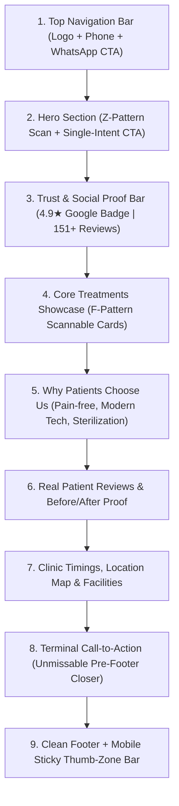

# Document 1: Content & Domain Model — Sai Specialized Dental Hospital

> **Project Tier:** Tier 1 (Static Showcase & Conversion Landing Page)  
> **Client:** Sai Specialized Dental Hospital  
> **Location:** Vipul Khand 2, Gomti Nagar, Lucknow  
> **Architect:** Kevin | High-Performance Web Development  

---

## 1. Business & Entity Overview

| Field | Detail |
| :--- | :--- |
| **Business Entity** | Sai Specialized Dental Hospital |
| **Industry / Niche** | Healthcare / Dental Clinic & Implant Center |
| **Verified Address** | Shop no. 102, Jeevan Plaza, near Study Hall School, Vipul Khand 2, Gomti Nagar, Lucknow, UP 226010 |
| **Verified Direct Phone** | `+91 92351 79344` (`092351 79344`) |
| **WhatsApp Booking Number** | `+91 92351 79344` |
| **Google Maps Reputation** | ⭐ **4.9 Stars** across **151+ Verified Patient Reviews** |
| **Primary Geographic Target** | Gomti Nagar, Indira Nagar, Vibhuti Khand, Lucknow |
| **Primary Commercial Wedge** | 1-Click WhatsApp Appointment Booking directly to reception desk |

---

## 2. Information Architecture & Section Hierarchy

The website follows Sam Crawford's **Conversion Architecture**: Every section leads toward a single commercial outcome (scheduling an appointment).

---

## 3. Section Content Specifications

### Section 1: Header / Navigation
- **Left:** Clinic Brand Identity (`SAI SPECIALIZED` + `Dental Hospital & Implant Centre`).
- **Right:** Quick Call (`+91 92351 79344`) + **"Book Appointment"** Teal Button.

### Section 2: Hero Section (Z-Pattern Scan Path)
- **Top Badge:** `📍 Trusted Dental Care in Gomti Nagar, Lucknow`
- **Primary Headline:** *"Gentle, Advanced Dental Care for Your Perfect Smile."*
- **Sub-headline (Max 65ch):** *"From painless single-sitting root canals to state-of-the-art dental implants, experience world-class treatments delivered with utmost care."*
- **Primary CTA:** **"Book Appointment on WhatsApp"** (Deep Teal with WhatsApp icon).
- **Secondary CTA:** **"Call Reception"** (Clean outline button with phone dialer).
- **Hero Image:** Modern, warm clinic environment / confident patient smile.

### Section 3: Social Proof Trust Stack (Above the Fold)
- **Metric 1:** `4.9 / 5.0` on Google Reviews.
- **Metric 2:** `150+` Verified Local Reviews.
- **Metric 3:** `100%` Sterilized & Hospital-Grade Hygiene.
- **Metric 4:** `0%` Pain Modern Equipment.

### Section 4: High-Ticket Treatments (Scannable Cards)
1. **Dental Implants & Fixed Teeth:** Permanent, natural-looking tooth replacements with titanium implants.
2. **Painless Single-Sitting Root Canal (RCT):** Modern rotary endodontics for zero-discomfort tooth saving.
3. **Invisible Aligners & Orthodontics:** Clear, discreet teeth straightening for teens and adults.
4. **Cosmetic Smile Design & Veneers:** Instant aesthetic smile makeovers and chipped tooth restorations.
5. **Advanced Teeth Whitening:** Fast, laser-assisted brightening for wedding & professional confidence.
6. **Kids & Preventive Dentistry:** Gentle, stress-free dental visits for children.

### Section 5: Why Patients Trust Sai Dental
- **Hospital-Level Sterilization:** 4-tier autoclave protocol ensuring total safety.
- **Modern Digital Diagnostics:** Low-radiation digital X-rays and intraoral cameras.
- **Transparent Pricing:** Clear treatment estimates before procedures begin.

### Section 6: Verified Patient Testimonials
- Real snippets extracted from Gomti Nagar patient reviews highlighting gentle care, punctual appointments, and clean facilities.

### Section 7: Clinic Details & Google Maps Embed
- **Timings:** Mon–Sat: 10:00 AM – 2:00 PM & 5:00 PM – 9:00 PM | Sunday: By Appointment.
- **Address & Landmarks:** Shop no. 102, Jeevan Plaza, Near Study Hall School, Vipul Khand 2, Gomti Nagar.
- **Interactive Google Maps Embed**.

### Section 8: Terminal Call-to-Action (The Closer)
- **Headline:** *"Ready for a Healthier, Confident Smile?"*
- **Sub-text:** *"Skip the waiting room. Book your consultation on WhatsApp in under 30 seconds."*
- **Button:** Large **"Book on WhatsApp"** Button + Instant Call link.

### Section 9: Mobile Sticky Thumb-Zone Bar (Viewports < 768px)
- Fixed at screen bottom:
  - Button 1: **📞 Call Now** (`tel:+919235179344`)
  - Button 2: **💬 WhatsApp** (`https://wa.me/919235179344?text=...`)
